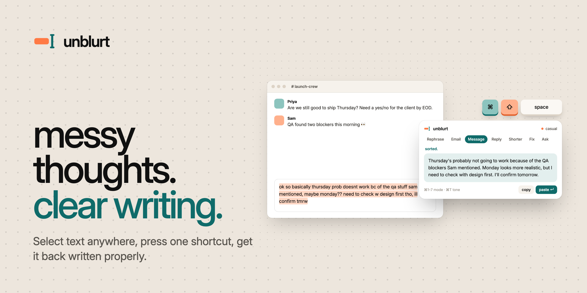
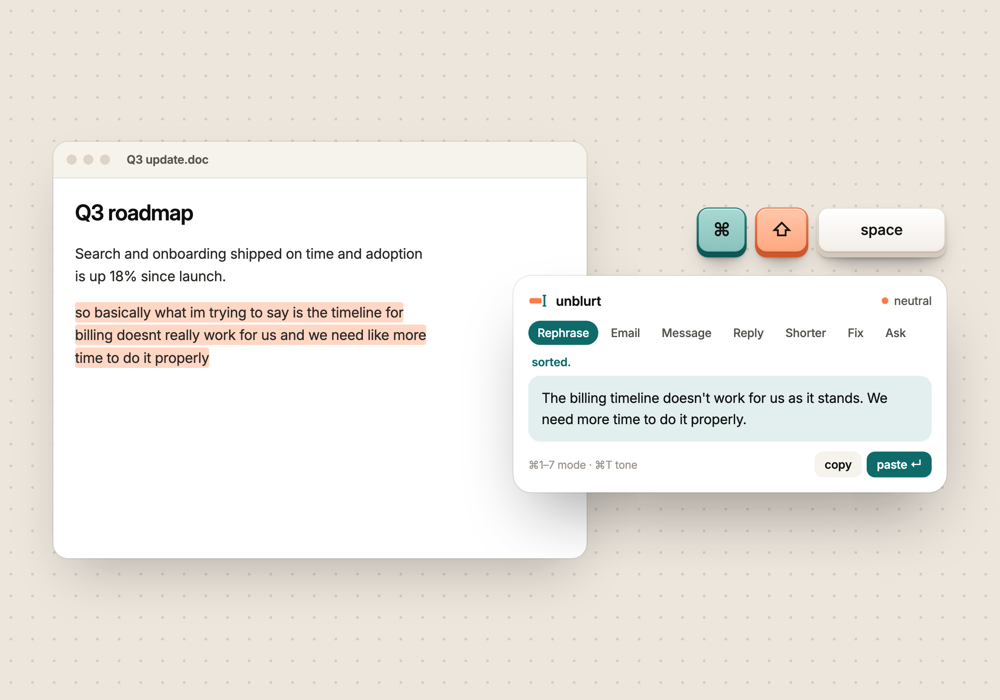
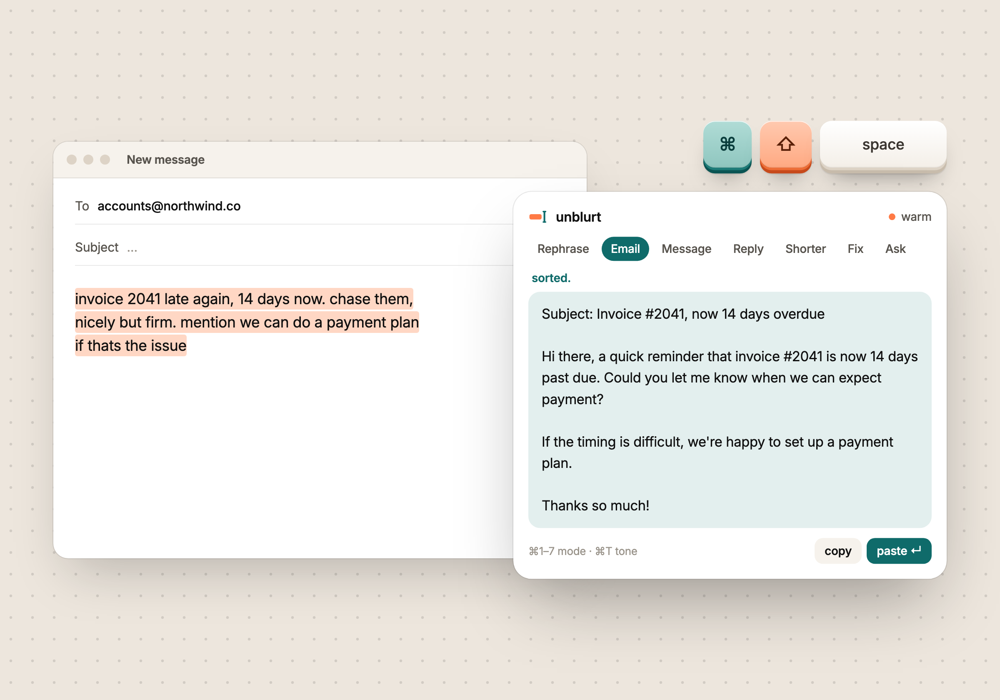
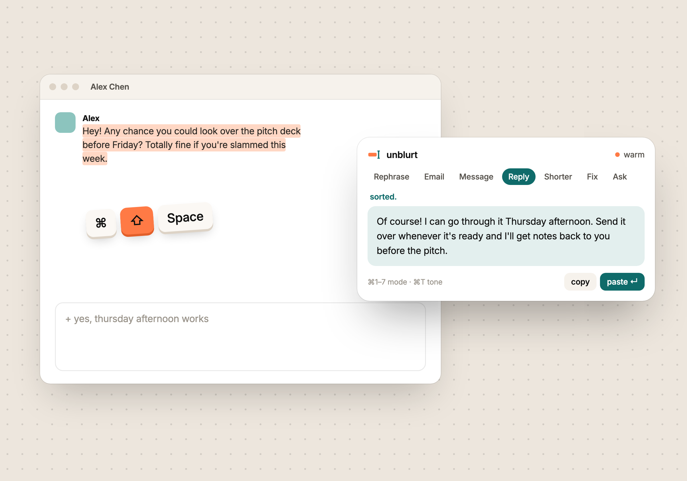
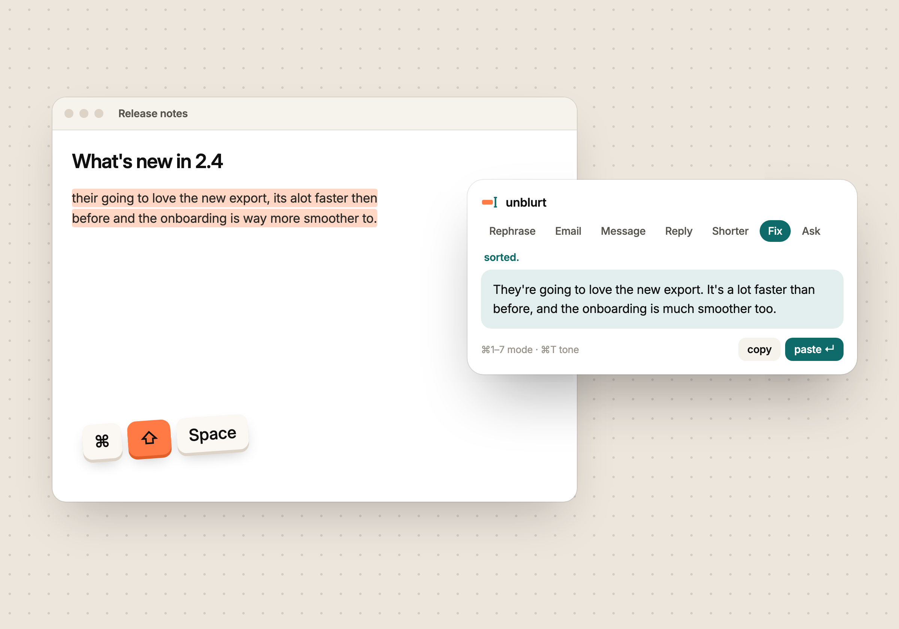
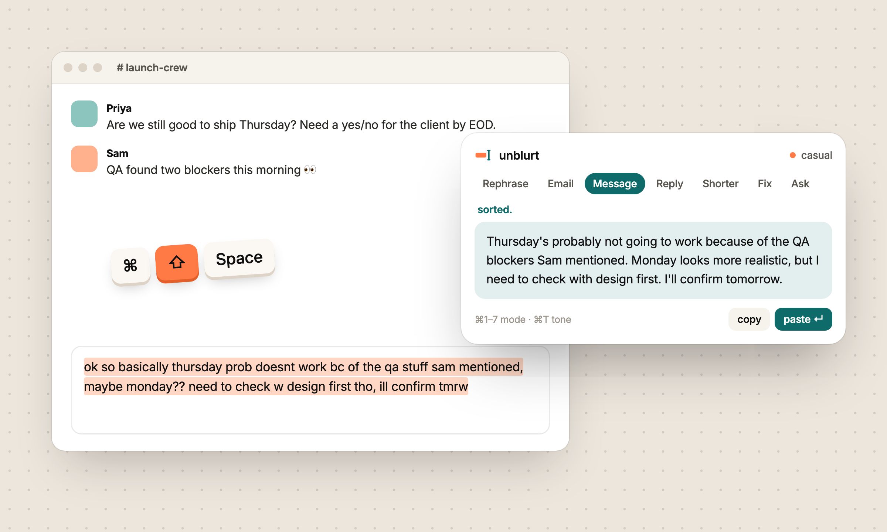
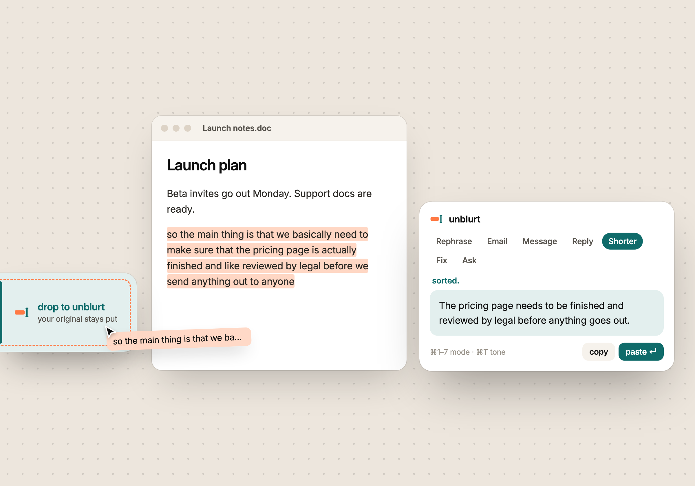
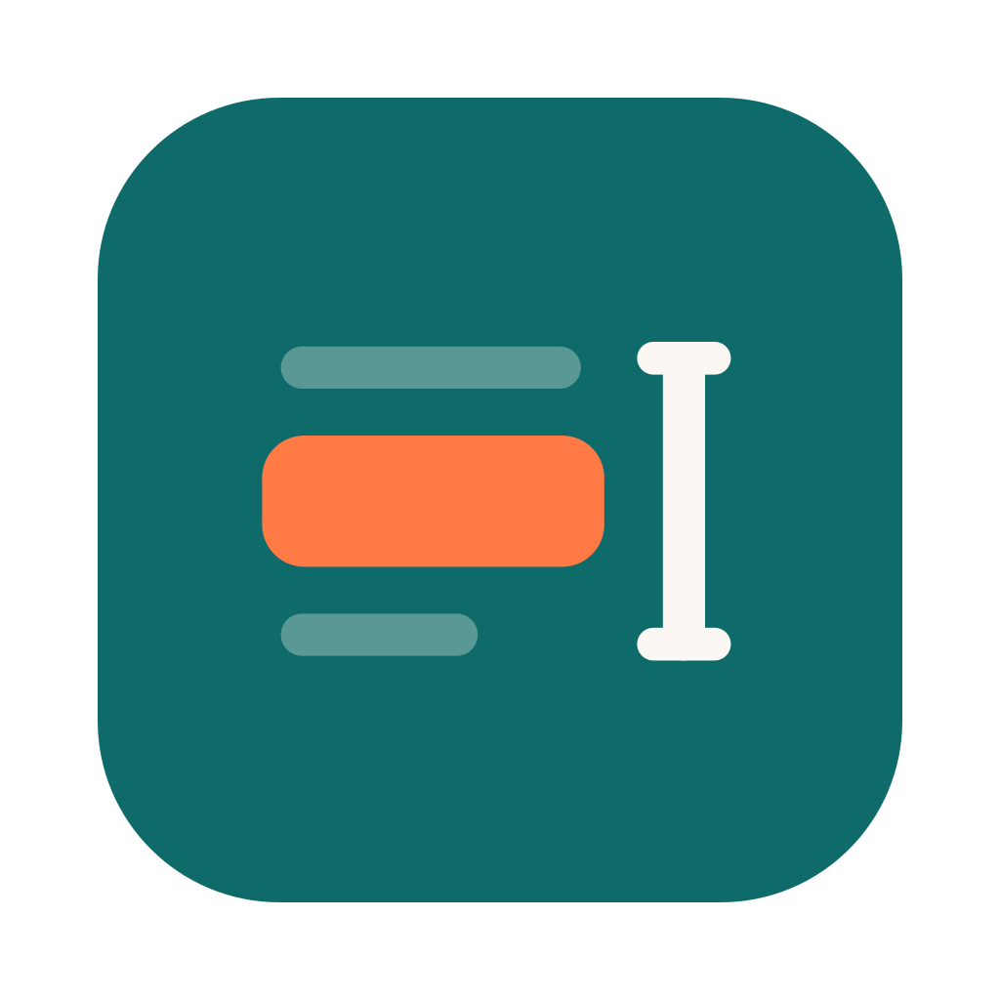

<p align="center">
  
</p>

<p align="center">
  <b>Select text anywhere. Press one shortcut. Get it back written properly.</b><br />
  A tiny desktop popover for every small writing job you used to open a chatbot for.<br />
  <a href="https://unblurt.me/#try"><b>Try it in your browser at unblurt.me</b></a>
</p>

<p align="center">
  <a href="https://unblurt.me"></a>
  <a href="https://github.com/Viral-Sachde/unblurt/releases/latest"></a>
  
  
  
  
</p>

<p align="center">
  <a href="#-how-it-feels">How it feels</a> ·
  <a href="#-modes">Modes</a> ·
  <a href="#-under-the-hood">Under the hood</a> ·
  <a href="#-quick-start">Quick start</a> ·
  <a href="#-repo-map">Repo map</a> ·
  <a href="#-brand">Brand</a>
</p>

---

## ✦ How it feels

```
  ┌──────────────────────────────────────────────────────────────┐
  │  so basically what im trying to say is the timeline          │   ← you, in Slack, mid-thought
  │  doesnt really work for us lol                               │
  └──────────────────────────────────────────────────────────────┘
                     ⌘ ⇧ Space   →   Rephrase   →   ↵
  ┌──────────────────────────────────────────────────────────────┐
  │  The timeline doesn't work for us as it stands.              │   ← pasted back, right where you were
  └──────────────────────────────────────────────────────────────┘
```

**Not dictation. Not another chat tab.** It's like Wispr Flow, but text in, text out. Highlight something (or start from nothing), hit the shortcut, pick a mode and a tone, press enter. The rewrite is pasted back into the app you were in, and your clipboard is put back the way it was.

**Hand on the mouse?** Drag the selected text onto the **plate**, a slim tab on the edge of your screen (left by default; grab its dots to move it to any side or corner). unblurt opens right beside it with that text, your original stays put, and paste replaces it when you're done. Hover the plate for three quick buttons: **Rephrase** or **Shorter** on whatever you have selected, or **Clipboard** for what you last copied. Hide it in settings if you'd rather not see it.

## ✦ Modes

| Key | Mode | What it does | Before → after |
|:---:|---|---|---|
| `⌘1` | **Rephrase** | Same meaning, better words | *"so basically what im trying to say…"* → *"The timeline doesn't work for us as it stands."* |
| `⌘2` | **Email** | Turns notes into a full email | *"invoice late again, chase them, nicely but firm"* → *"Subject: Invoice #2041, now 14 days overdue…"* |
| `⌘3` | **Message** | Chat-length, human, sendable | *"running late 10 min start without me pls"* → *"Running about 10 minutes late, so go ahead and start without me."* |
| `⌘4` | **Reply** | Answers the selected text with your gist | Select their message, add *"yes but next week"* |
| `⌘5` | **Shorter** | Cuts it down, keeps the point | |
| `⌘6` | **Fix** | Grammar and spelling only, keeps your voice | |
| `⌘7` | **Ask** | Free-form instruction on the selection | *"make this a bulleted list"* |

<table>
  <tr>
    <td width="50%"><br /><sub><b>Rephrase</b> · a rambling doc sentence, made clear</sub></td>
    <td width="50%"><br /><sub><b>Email</b> · rough notes into a sendable email</sub></td>
  </tr>
  <tr>
    <td width="50%"><br /><sub><b>Reply</b> · their message plus your gist</sub></td>
    <td width="50%"><br /><sub><b>Fix</b> · spelling and grammar, your words kept</sub></td>
  </tr>
  <tr>
    <td width="50%"><br /><sub><b>Message</b> · a messy Slack draft, ready to send</sub></td>
    <td width="50%"><br /><sub><b>The plate</b> · drag text to the screen edge instead of using the shortcut</sub></td>
  </tr>
</table>

**Tones** (`⌘T` to cycle): `casual` · `neutral` · `warm` · `direct` · `formal`

**Popover keys:** `↵` run, then `↵` paste · `⌘C` copy · `⌘R` again · `⌘E` back to edit · `esc` close · `⌘,` settings

> On Windows and Linux, `⌘` is `Ctrl`.

## ✦ Under the hood

```
 any app ──⌘⇧Space──▶ Rust: copy selection (simulated ⌘C, clipboard restored)
                        │
                        ▼
                 popover window (React) ── mode + tone + note ──▶ prompt
                        │
                        ▼
      Rust ──HTTP──▶ opencode serve (127.0.0.1, random port, started by unblurt)
                        │   agent "unblurt": no tools, writing-only prompt
                        ▼
                 result ──↵──▶ hide, return focus, simulated ⌘V into the original app
```

- **Bring your own model.** unblurt runs on [opencode](https://opencode.ai), so it works with any provider you've connected using `opencode auth login`. Pick a model in Settings or use opencode's default.
- **Local and disposable.** unblurt starts a private `opencode serve` on `127.0.0.1` with its own config in the app-data folder. Each rewrite gets a throwaway session that's deleted afterwards.
- **No tools, just writing.** The `unblurt` agent can't run commands, read files or browse. It rewrites text and nothing else.
- **Honest failures.** When a provider is rate-limited or out of quota, opencode retries silently. unblurt watches `/session/status` and tells you why instead of spinning forever.
- **Finds opencode on its own.** It asks your login shell for the path, because GUI apps don't inherit `PATH`. Set `UNBLURT_OPENCODE=/path/to/opencode` to override.

## ✦ Download

Installers for macOS (Apple silicon and Intel), Windows and Linux are on the [**Releases page**](https://github.com/Viral-Sachde/unblurt/releases/latest), and at [unblurt.me/download](https://unblurt.me/download). What changed in each version is in [`CHANGELOG.md`](CHANGELOG.md).

The beta builds aren't signed with a paid certificate yet. On first open, macOS needs **System Settings → Privacy & Security → Open Anyway**; Windows needs **More info → Run anyway**.

## ✦ Quick start

**1. Get the engine**

```bash
curl -fsSL https://opencode.ai/install | bash   # or: npm i -g opencode-ai
opencode auth login                             # connect a provider
```

**2. Run the app**

```bash
cd apps/desktop
npm install
npm run tauri dev       # develop
npm run tauri build     # installers: .dmg/.app · .msi/.exe · .AppImage/.deb/.rpm
```

You'll need Node 18+, [Rust](https://rustup.rs) stable, and the [Tauri prerequisites](https://v2.tauri.app/start/prerequisites/) for your OS.

**3. Grant Accessibility (macOS).** On first use, go to System Settings → Privacy & Security → Accessibility and allow unblurt. It needs this to send `⌘C`/`⌘V` for you.

More detail in [`apps/desktop/README.md`](apps/desktop/README.md).

## ✦ Releasing

One version number lives in three files (`apps/desktop/package.json`, `src-tauri/tauri.conf.json`, `src-tauri/Cargo.toml`). Keep them in step with the script:

```bash
node scripts/set-version.mjs 0.2.0     # bump all three
# add a "## [0.2.0] - YYYY-MM-DD" section to CHANGELOG.md
git commit -am "Release v0.2.0"
git tag v0.2.0 && git push origin main v0.2.0
```

Pushing the tag runs [`.github/workflows/release.yml`](.github/workflows/release.yml): it checks the versions and the changelog match the tag, tests and builds on macOS (Apple silicon and Intel), Windows and Linux, uploads the installers and publishes the release with that changelog section as its notes. The download page picks up the new files by itself. [`ci.yml`](.github/workflows/ci.yml) builds and tests every push to `main`.

## ✦ Repo map

```
unblurt/
├── .github/workflows/  CI on every push; release builds on every v* tag
├── scripts/          set-version, check-version, release-notes, wall-review (website wall moderation)
├── apps/
│   ├── desktop/          Tauri 2 + React popover app (macOS, Windows, Linux)
│   │   ├── src/          React UI: popover, settings, modes and prompts
│   │   └── src-tauri/    Rust: hotkey, clipboard, keystrokes, opencode process
│   └── web/              unblurt.me: static HTML/CSS/JS (no build step) plus three tiny API functions
│                         for the live numbers and the visitor wall. Try it, the how-blurty score and
│                         blurt of the day all run in the browser.
└── brand/                Logo, app icon, tray icon, illustrations, creatives
    └── creatives/        Product shots, banner and social preview, rendered from HTML
```

| Folder | Read more |
|---|---|
| `apps/desktop` | [Desktop app →](apps/desktop/README.md) |
| `apps/web` | [Website and deploy →](apps/web/README.md) |
| `brand` | [Brand kit →](brand/README.md) |

## ✦ Why Tauri

| Option | Footprint | Verdict |
|---|---|---|
| **Tauri 2 + React** ✅ | ~10 MB app, ~40 MB RAM | Native webview, Rust for hotkeys, clipboard and keystrokes, one codebase for three OSes. Right for an app that sits in the tray all day. |
| Electron + React | ~150 MB, 150+ MB RAM | Mature and JS-only, but heavy for something that's always running. |
| Flutter desktop | ~30 MB | Good UI control, but global hotkeys and simulated paste depend on uneven plugins. |
| Native (SwiftUI + WinUI) | smallest | Most polish, but two apps to maintain. Worth revisiting for a premium Mac build. |

## ✦ Brand

<p align="center">
  
  &nbsp;&nbsp;&nbsp;
  
</p>

Petrol teal `#0F6B6A` · persimmon `#FF7A45` · warm stone `#EDE6DD` · ink `#101010` · set in **Inter**. The full kit is in [`brand/`](brand/README.md).

## ✦ Known limits (v0.1)

- [ ] Clipboard restore keeps text only. An image on the clipboard is lost after a selection grab.
- [ ] Wayland blocks simulated keystrokes in many compositors, so you may have to paste manually on Linux.
- [ ] Rewrites aren't streamed yet. The popover shows a working state until the full answer arrives.

---

<p align="center">
  <br />
  <sub><b>your brain, unfiltered. your words, sorted.</b></sub>
</p>
