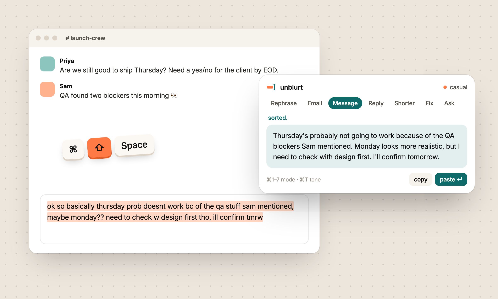

<p align="center"></p>

# unblurt desktop

The app itself: a Tauri 2 shell in Rust with a React popover. It lives in the menu bar or tray and wakes up on `⌘⇧Space` (`Ctrl+Shift+Space` on Windows and Linux).

## Develop

```bash
# once: the engine
curl -fsSL https://opencode.ai/install | bash
opencode auth login

# the app
npm install
npm run tauri dev
```

You need Node 18+, [Rust](https://rustup.rs) stable and the [Tauri prerequisites](https://v2.tauri.app/start/prerequisites/):

| OS | Extra deps |
|---|---|
| macOS | Xcode Command Line Tools |
| Windows | WebView2, MSVC build tools |
| Linux | `webkit2gtk-4.1`, `libxdo-dev`, and the rest of the Tauri list |

## Build

```bash
npm run tauri build
```

| OS | Output |
|---|---|
| macOS | `.app`, `.dmg` |
| Windows | `.msi`, `.exe` |
| Linux | `.AppImage`, `.deb`, `.rpm` |

Installers only build for the OS you're on. Build on each platform, or use [`tauri-action`](https://github.com/tauri-apps/tauri-action) in GitHub Actions.

**macOS:** the first time you use it, allow unblurt under System Settings → Privacy & Security → Accessibility. It needs this to send `⌘C` and `⌘V` for you.

## Code map

```
src/
├── popover/Popover.tsx    The window that appears on the shortcut: modes, tone, note, result
├── plate/Plate.tsx        The drop target on the left screen edge: drag text onto it, or click it
├── settings/Settings.tsx  Engine status, model picker, shortcut, plate, default tone
├── lib/modes.ts           The seven modes, five tones and the prompt builder (edit prompts here)
├── lib/api.ts             Typed wrappers around the Tauri commands
├── lib/prefs.ts           Local preferences
└── components/Mark.tsx    The logo as a component

src-tauri/src/
├── lib.rs        App setup, tray, global shortcut, window handling, Tauri commands
├── keys.rs       Grabs the selection (simulated copy) and pastes the result back, restoring the clipboard
└── opencode.rs   Finds opencode, runs a private `opencode serve`, creates and deletes sessions, reports status
```

**Tauri commands:** `transform` · `list_models` · `engine_status` · `restart_engine` · `paste_text` · `copy_text` · `hide_popover` · `open_settings` · `set_hotkey` · `plate_drop` · `plate_click` · `set_plate` · `quit`

**The plate** is its own window (`label: "plate"`) that is never focusable, so clicking or dropping on it leaves the app you were in frontmost. That's what lets a click grab the selection like the shortcut does, and lets paste land back in the source app. `dragDropEnabled` is off for it so the webview gets real HTML drag events with the dropped text. It is 16px wide at rest, widens on hover and to a landing pad while text is dragged over it.

## Engine

unblurt doesn't call any model API directly. On launch it:

1. Finds `opencode` by asking your login shell, since GUI apps don't inherit `PATH`. Set `UNBLURT_OPENCODE=/path/to/opencode` to override this.
2. Starts `opencode serve` on `127.0.0.1` on a random port, with its own config in the app-data folder.
3. Defines an `unblurt` agent that has no tools and only rewrites text.
4. Uses a fresh session for every rewrite and deletes it afterwards.
5. Watches `/session/status`. If a provider is rate-limited or out of quota, the popover shows why instead of hanging.

## Icons

```bash
npm run icons   # regenerates src-tauri/icons from brand/app-icon.svg
```
