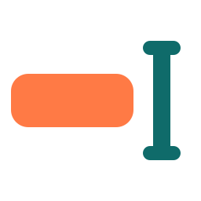
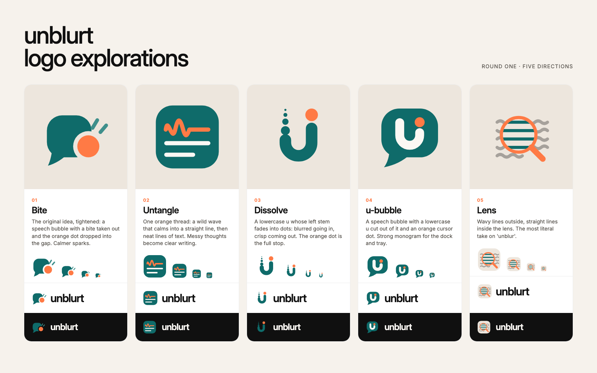
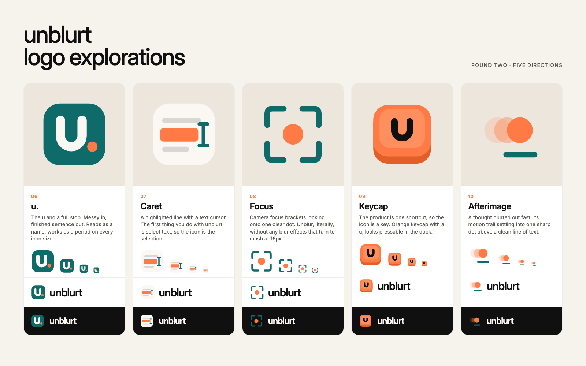
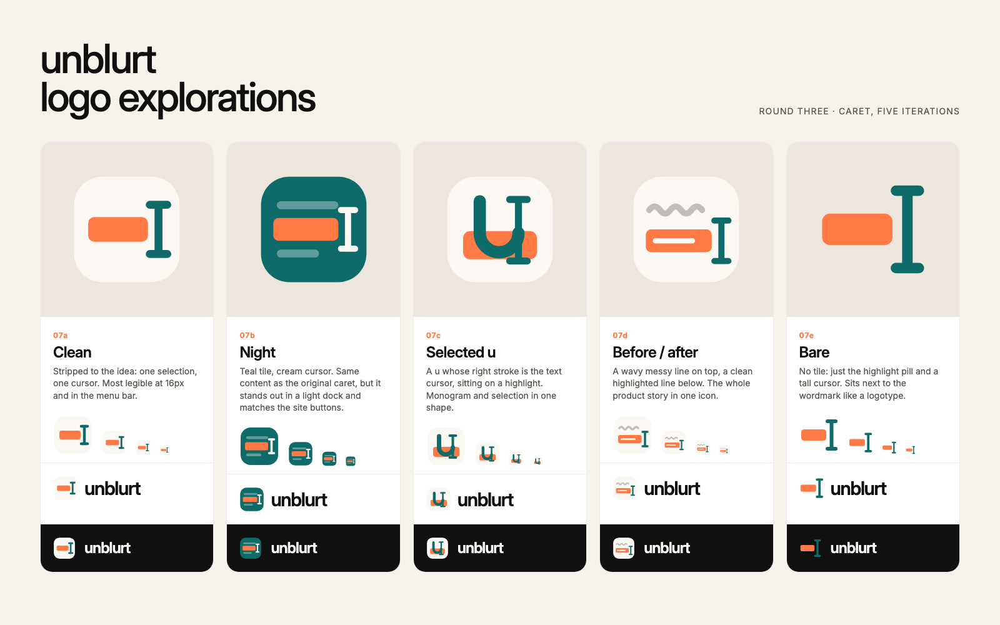

<p align="center"></p>

<h1 align="center">unblurt brand kit</h1>

<p align="center">Everything that makes unblurt look like unblurt.</p>

---

## Palette

| | Name | Hex | Use |
|---|---|---|---|
|  | Petrol teal | `#0F6B6A` | Primary. Buttons, the active mode, the logo body |
|  | Persimmon | `#FF7A45` | Accent. The dot, the shift key, text selections |
|  | Warm stone | `#EDE6DD` | Canvas behind illustrations and product shots |
|  | Ink | `#101010` | Text |

Supporting tints: teal tint `#E3EFEE` (result box), persimmon tint `#FFD7C4` (selected text), stone soft `#F6F2EC`, cream `#FBF8F4`.

**Type:** [Inter](https://rsms.me/inter/), weight 500 with tight tracking (about -0.04em) for headlines, 400 for body. Manrope is the fallback.

**Voice:** lowercase, short and a bit dry. *messy thoughts. clear writing.* · *your brain, unfiltered.* · *your words, sorted.* No em dashes anywhere; use a comma, colon or full stop instead.

## Files

| File | What it is |
|---|---|
| [`logo.mjs`](logo.mjs) | Source of truth for the logo. `node brand/logo.mjs` writes every file below plus the desktop `Mark.tsx` |
| [`mark.svg`](mark.svg) | The logo: a highlighted selection and a text cursor (Caret, polished) |
| [`app-icon.svg`](app-icon.svg) | 1024px app icon: the Caret on a teal tile. Run `npm run icons` in `apps/desktop` to rebuild every platform size |
| [`tray.svg`](tray.svg) | Single-colour template icon for the macOS menu bar and the system tray |
| [`illustrations.mjs`](illustrations.mjs) | Generates the isometric keycap illustration: `node brand/illustrations.mjs apps/web/assets` |
| [`explorations/`](explorations) | Ten logo directions plus five Caret iterations, with comparison sheets |
| [`creatives/`](creatives) | Product shots, README banner and social preview image |

## Logo explorations

### Round one



| # | Direction | Idea |
|---|---|---|
| 01 | **Bite** | The current mark, tightened. A speech bubble with a bite taken out and the orange dot sitting in the gap |
| 02 | **Untangle** | One orange line that starts as a wild wave and settles into a straight line above two neat lines of text |
| 03 | **Dissolve** | A lowercase *u* whose left stem breaks up into dots (blurred) while the right stays solid (clear). The orange dot is the full stop |
| 04 | **u-bubble** | A speech bubble with a lowercase *u* cut out of it and an orange cursor dot. The strongest at dock and tray sizes |
| 05 | **Lens** | Wavy lines outside a lens and straight lines inside it. The most literal take on *unblur* |

### Round two



| # | Direction | Idea |
|---|---|---|
| 06 | **u.** | A lowercase u and a full stop: messy in, finished sentence out |
| 07 | **Caret** | A highlighted line and a text cursor, because selecting text is step one |
| 08 | **Focus** | Camera focus brackets locking onto one clear dot |
| 09 | **Keycap** | The product is one shortcut, so the icon is a key with a u on it |
| 10 | **Afterimage** | A blurted thought's motion trail settling into one sharp dot above a clean line |

### Round three: Caret, five iterations



| # | Iteration | Idea |
|---|---|---|
| 07a | **Clean** | One selection and one cursor, nothing else. The most legible at 16px and in the menu bar |
| 07b | **Night** | Teal tile with a cream cursor. Stands out in a light dock and matches the site buttons |
| 07c | **Selected u** | A u whose right stroke is the text cursor, sitting on a highlight |
| 07d | **Before / after** | A wavy messy line above a clean highlighted one: the product in one icon |
| 07e | **Bare** | No tile, just the highlight pill and a tall cursor. Sits next to the wordmark like a logotype |

**Chosen:** the Caret direction (07), polished: straight rounded I-beam, highlight centred on it. App icon uses the teal tile (07b), everything else the bare mark (07e).

To change it again, copy its SVG over `mark.svg` (and `apps/web/assets/mark.svg`), redraw `app-icon.svg` and `tray.svg` to match, then rerun `npm run icons` and `creatives/render.sh`.

## Creatives

The product shots show the real flow: messy text selected in an ordinary app, `⌘ ⇧ Space`, and the unblurt popover with the clean version ready to paste. They're plain HTML, so the copy is easy to change.

| File | Size | Used for |
|---|---|---|
| `creatives/product.html#message` | 1200×720 @2x | Website hero |
| `creatives/product.html#email` `#rephrase` `#fix` `#reply` | 1200×840 @2x | Website showreel, README |
| `creatives/banner.html` | 1280×640 @2x | README banner, `og:image` |

To add a scene, add an entry to the `S` object in `product.html`. Then run:

```bash
brand/creatives/render.sh   # renders everything with headless Chrome and copies it to apps/web/assets
```
